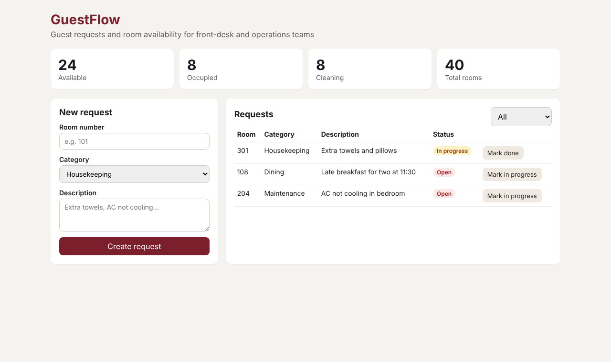

# GuestFlow – Hotel Guest Requests & Room Availability

A full-stack hospitality service for front-desk and operations teams: log guest requests (housekeeping, maintenance, dining, concierge), move them through a controlled workflow, and see live room availability.



**Stack:** .NET 8 / C# minimal API · React + TypeScript · SQL Server · Redis · Docker · Terraform on Azure Container Apps · xUnit · Playwright · k6 · GitHub Actions

## Architecture

```
Browser ──► web (React + nginx) ──/api──► api (.NET 8, C#) ──► SQL Server   (source of truth)
                                              │
                                              └──────────► Redis        (cache-aside, 30 s TTL)
```

| Concern | How it's handled |
|---|---|
| Distributed services | Separate web and API containers talking over REST; the API is stateless and scales out (1–3 replicas in Azure) |
| Caching | Room availability uses the **cache-aside** pattern in Redis. Front-desk screens poll every 15 s, so most reads never touch SQL. The cache is invalidated on room changes, and the API falls back to SQL if Redis is down |
| Data | SQL Server via EF Core: unique room numbers, indexed request status, enums stored as readable strings |
| Validation | Field validation (400 with field errors) and a status workflow: Open → In progress → Done. Invalid moves return 409 |
| Observability | `/health` endpoint (checks SQL), structured logs, a custom `guestflow.requests.created` metric, and an `X-Cache: HIT/MISS` header |
| Alerts | Azure Monitor emails on-call when there are more than 10 HTTP 5xx in 5 min, or when the container restarts repeatedly |
| Infrastructure as Code | Terraform creates the resource group, Log Analytics, Azure SQL (serverless, auto-pause), the Container Apps environment, the apps and the alerts |
| Testing | xUnit unit tests (business rules, cache logic), xUnit integration tests (real HTTP pipeline in memory), Playwright end-to-end tests and k6 load tests with SLO thresholds |
| CI/CD | GitHub Actions runs build → unit/integration tests → Docker stack + Playwright → Terraform validate, then publishes images to GHCR |

## Run it locally (one command)

You need: **Docker Desktop**.

```bash
docker compose up --build
```

- Web app: http://localhost:3000
- API docs (Swagger): http://localhost:8080/swagger
- Health: http://localhost:8080/health

The first start takes a minute while SQL Server boots. The API retries until the database is ready, then seeds 40 rooms (101–110, 201–210, 301–310, 401–410).

## Run the tests

```bash
# Unit + integration tests (needs the .NET 8 SDK)
cd api && dotnet test

# End-to-end tests (stack must be running via docker compose)
cd e2e && npm ci && npx playwright install chromium && npx playwright test

# Load test (install k6 from https://k6.io)
k6 run load/availability-load-test.js
```

No Docker? Run the front end against the built-in mock API:

```bash
cd e2e && npm ci && npm run mock-api        # terminal 1 – fake API on :8080
cd web && npm ci && npm run dev             # terminal 2 – http://localhost:5173
E2E_BASE_URL=http://localhost:5173 npx playwright test   # terminal 3 (from e2e/)
```

## Deploy to Azure with Terraform

1. Push this repo to GitHub. The CI `publish` job pushes images to `ghcr.io/<you>/guestflow-api` and `guestflow-web`. In GitHub → your profile → Packages, set both packages to **Public**.
2. Install the [Azure CLI](https://learn.microsoft.com/cli/azure/install-azure-cli) and [Terraform](https://developer.hashicorp.com/terraform/install), then run `az login`.
3. Deploy:

```bash
cd infra/terraform
cp terraform.tfvars.example terraform.tfvars   # fill in your images, a strong SQL password, your email
terraform init
terraform plan
terraform apply
```

4. Open the `web_url` it prints. When you're done, run `terraform destroy` so you aren't billed.

**Cost:** Container Apps includes a monthly free grant, and Azure SQL serverless auto-pauses after an hour idle. Expect a few dollars a month at most if you leave it running. Destroy it after your interviews.

## Project layout

```
api/GuestFlow.Api     .NET 8 minimal API (C#): endpoints, EF Core, Redis cache service
api/GuestFlow.Tests   xUnit unit + integration tests
web/                  React + TypeScript (Vite), served by nginx in Docker
e2e/                  Playwright end-to-end tests + mock API
load/                 k6 load test with SLO thresholds
infra/terraform       Azure infrastructure + monitoring alerts
.github/workflows     CI/CD pipeline
```
